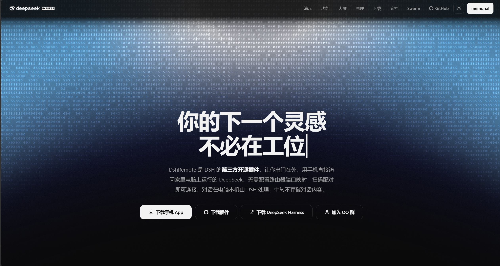
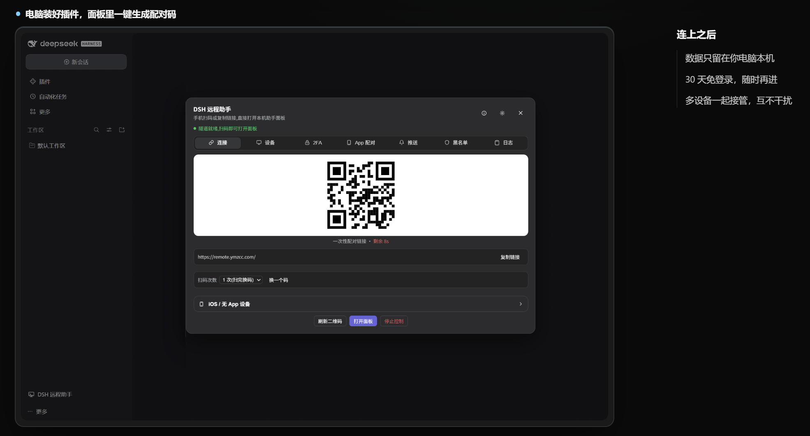
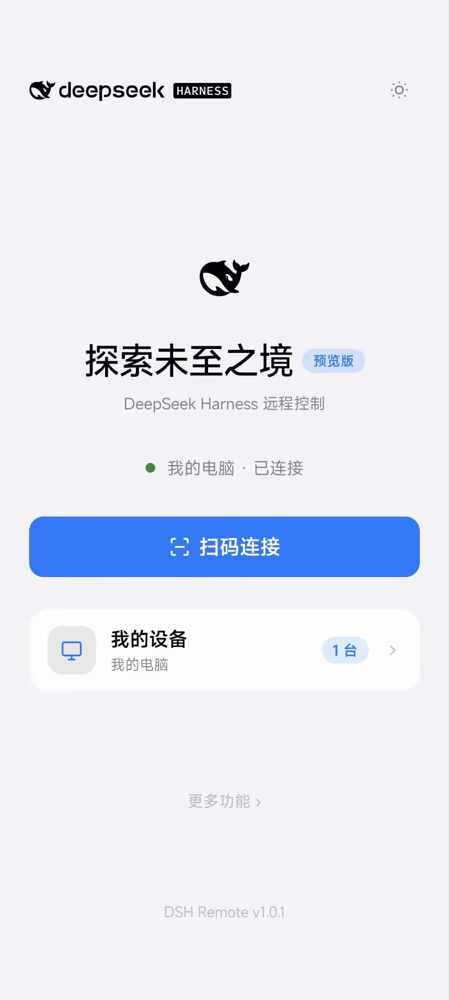
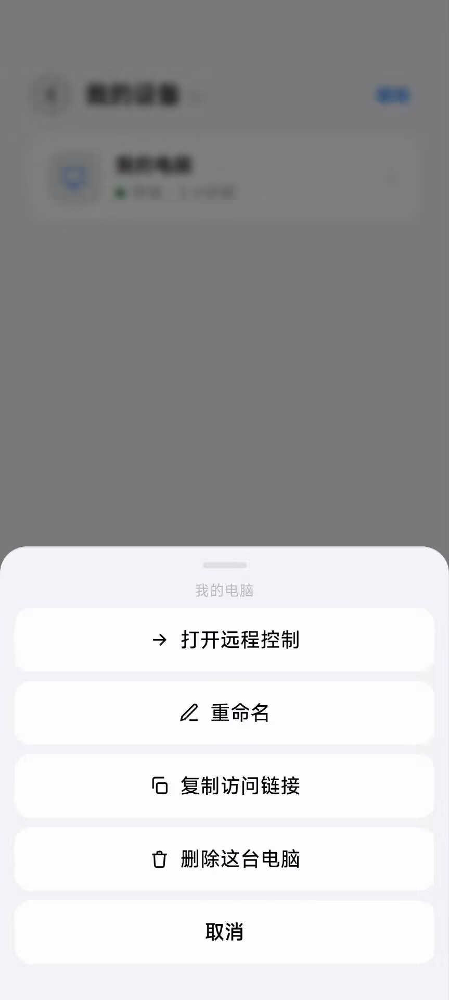
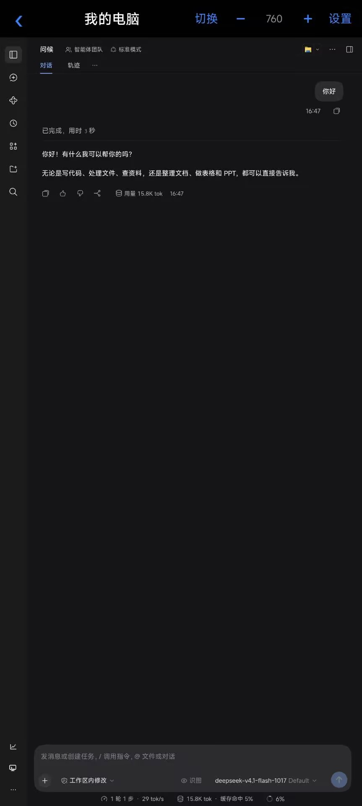
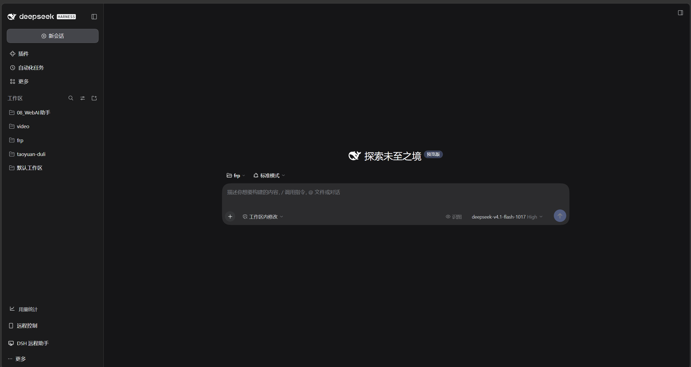

# DshRemote · 让 DeepSeek 助手随时随地远程访问

> DSH 远程助手（DshRemote）：一款 [DeepSeek Harness (DSH)](https://dsh.venice.ai) Web 面板配套工具，
> 一键把本机 DSH 面板安全穿透到手机与外网浏览器，随时随地远程控制自己的电脑，全程 AI 辅助。

> 在线体验：[立即体验 DshRemote](https://remote.ymzcc.com/dsh-remote/)
> 链接地址：`https://remote.ymzcc.com/dsh-remote/`

<p align="center">
  <a href="https://remote.ymzcc.com/dsh-remote/" target="_blank">
    
  </a>
  <a href="https://github.com/Memorial-coder/dsh-remote-plugin" target="_blank">
    
  </a>
</p>

<p align="center">
  
</p>

### 🚀 快速访问

> [!IMPORTANT]
> **官网体验**：[https://remote.ymzcc.com/dsh-remote/](https://remote.ymzcc.com/dsh-remote/)
> **官方交流群**：1134820071 (QQ)

<p align="center">
  <a href="https://remote.ymzcc.com/dsh-remote/">在线体验</a> ·
  <a href="INSTALL.md">安装指南</a> ·
  <a href="https://github.com/Memorial-coder/dsh-remote-plugin">GitHub 仓库</a> ·
  QQ 交流群：1134820071
</p>

## 功能一览

| 功能 | 说明 |
|------|------|
| 扫码即连 | 手机扫描二维码，30 秒内完成配对，无需配置路由器端口映射 |
| 一次性 / 长期配对 | 临时会话用一次性码，常用设备用长期配对码自动保存 |
| 场景配对 | 支持 iOS / 无 App 设备通过 Safari 验证，30 天免登录 |
| 两步验证 2FA | TOTP (RFC 6238) 动态验证码 + 30 天 Cookie 设备信任，兼顾安全与便捷 |
| 设备管理 | 在线设备列表、设备详情、一键踢下线 |
| IP 黑名单 | 暴力破解自动封禁，自定义黑名单规则 |
| 消息推送 | Windows 原生 Toast 推送，安全事件实时提醒 |
| 操作日志 | 配对、踢人、验证等关键操作全记录 |
| PWA 支持 | 添加到手机主屏幕全屏使用，无需安装 App |
| 自建 / 托管 | 默认官方服务器即开即用，也支持自建 frps 服务器 |
| 多用户隔离 | 每位用户专属入口，设备互不干扰 |
| 引导链接 | 生成一次性引导链接分享给朋友，免注册直接访问 |

## 截图

### 插件面板：扫码连接

<p align="center">
  
</p>

DSH 侧边栏的远程控制面板，集成了二维码配对、设备管理、两步验证、App 配对、消息推送、黑名单和日志查看等功能，一站式管理所有远程连接。

### 手机 App：三步连接

<p align="center">
  
</p>

三步完成连接：
1. 电脑端插件一键生成配对码
2. 手机扫描二维码，30 秒验证
3. 验证成功后 30 天内免登录，随时远程接管

### 手机 App 首页

<p align="center">
  
</p>

已连接的设备一目了然，支持多设备管理。点击「扫码连接」随时添加新设备。

### 远程控制：AI 对话

<p align="center">
  
</p>

连接成功后直接在手机上操控 DeepSeek 助手，写代码、处理文件、整理文档，和本地使用完全一样。

### 桌面客户端

<p align="center">
  
</p>

完整的 DeepSeek Harness 桌面体验：工作区管理、插件扩展、自动化任务、远程控制入口。

## 快速开始

**装之前先确认两件事**：

- **需要一个官方账号**：官方托管模式要先去 <https://remote.ymzcc.com> 注册（免费），登录后服务器才分配专属端口。
- **Windows 上 `frpc.exe` 可能被判为 `PUA:Win32/FRProxy` 拦截**：解压后先双击 `fix-antivirus.bat`（推荐；或右键 `fix-antivirus.ps1` →「使用 PowerShell 运行」） → UAC 点「是」，否则隧道起不来、手机打开是 502。

完整安装步骤见 [INSTALL.md](INSTALL.md)。想先看效果？直接打开官网：[https://remote.ymzcc.com/dsh-remote/](https://remote.ymzcc.com/dsh-remote/)。

**官方托管**（推荐）：登录官方账号即用，服务器自动分配专属入口

```
1. 解压插件包（Windows 先跑一次 fix-antivirus.bat，双击即可）
2. DSH →「设置」→ 插件页 →「添加插件」→「选择本地目录」→ 选中插件包根目录 → 重启 DSH
3. 侧边栏「远程助手」→ 登录官方账号 → 点「开始控制」→ 手机扫码二维码远程访问
```

**自建服务器**：配置自己的 frps 服务器；密钥仅保存在本机，不会被提交或上传

**从 GitHub 仓库根安装**（开发/尝鲜）：仓库根另有一份同名 `package.json`，`dsh.bundle` 指到 `dsh-plugin-browserctl/cordis.patch.yml`，所以仓库根也是合法插件包，`lib/` 已入库、不需要 `npm install`：

```sh
dsh plugin add github:Memorial-coder/dsh-remote-plugin
```

或在「添加插件 → 选择本地目录」里直接选仓库根目录。发版产物（zip / tgz）的目录结构不变。

## 架构

```
手机/外网浏览器
  → https://remote.ymzcc.com/dsh-remote/p/<uid>/    (官方托管: 每位用户专属入口, HTTPS 443)
  → OpenResty/Nginx (Lua Cookie 签名门禁)
  → frps (KCP/UDP)
  → frpc 隧道
  → 本机闸机 browserctl.py（2FA + 会话 + 看门狗）
  → DSH Web 面板
```

> 说明：官方托管模式下每位用户登录后都有自己的专属入口 `/dsh-remote/p/<uid>/`（uid 稳定，换端口不断连）。

## 安全性

- **数据本地**：所有 AI 对话和文件处理都在本机 DSH 中运行，数据不上传第三方服务器
- **全程 TLS 加密**：手机 → 官方 frps/Nginx → 本机闸机全程 TLS；数据始终留在本机，不经第三方明文
- **双重验证**：TOTP 2FA + Cookie 设备信任，暴力破解自动封禁
- **设备隔离**：多设备同时在线互不干扰，支持定向踢出

## 目录结构

插件包是自包含目录（DSH 里「添加插件 → 选择本地目录」选中的就是它），运行时零 npm 依赖：

```
插件包根/                     ← DSH 里「添加插件 → 选择本地目录」选中的就是它
├── package.json            DSH 插件清单（main → lib/index.js）
├── cordis.patch.yml        插件注册补丁（向 profile 插入插件行）
├── lib/                    预构建产物（esbuild，已入库）
│   ├── index.js            host 半：API 路由注册（qrcode 已内联）
│   └── client.js           client 半：侧边栏面板 UI
├── src/                    插件源码
├── locale/                 中文 / 英文文案
├── icon.svg                侧边栏图标
├── browserctl.py           核心闸机（单文件，只用 Python 标准库）
│                           ├── 本地 HTTP 网关
│                           ├── frpc 隧道管理
│                           ├── TOTP 2FA 验证
│                           ├── 设备配对与会话管理
│                           ├── IP 黑名单与暴力破解防护
│                           ├── 看门狗进程（自动恢复）
│                           └── CLI 命令行工具
├── frpc.exe                FRP 客户端（Windows）
├── win_push.py             消息推送驻留
├── push_toast.ps1          PowerShell 推送脚本
├── browserctl_pwa/         PWA 图标与 Service Worker
├── fix-antivirus.ps1       一键修复 frpc.exe 被 PUA 拦截
├── fix-antivirus.bat       一键修复的双击启动器（跑完窗口停住）
└── INSTALL.md / LICENSE
```

`qrcode` 已在构建期内联进 `lib/index.js`，运行时不需要 `node_modules`。仓库另带 `screenshots/`（本 README 引用的功能截图）。

仓库根还有 `package.json`（同名，`dsh.bundle` 指向插件子包，供 `dsh plugin add` 与插件市场读取）、`screenshots.json`（市场商店截图声明，6 张相对路径）和 `submission/`（投稿到 awesome-dsh-plugin 的条目副本，不参与打包）。

## 开源许可

MIT License · 2026 DshRemote Project

---

<p align="center">
  <a href="https://remote.ymzcc.com/dsh-remote/">在线体验</a> ·
  <a href="INSTALL.md">安装指南</a> ·
  <a href="https://github.com/Memorial-coder/dsh-remote-plugin">GitHub 仓库</a> ·
  QQ 交流群：1134820071
</p>

**注意**：不需要单独安装 Python 或 Node —— 插件按序探测 `BROWSERCTL_PYTHON`、包内 `python/`、DSH 自带运行时、PATH，`browserctl.py` 只用标准库。官网 [https://remote.ymzcc.com/dsh-remote/](https://remote.ymzcc.com/dsh-remote/) 开箱即用，也支持自建 frps。
